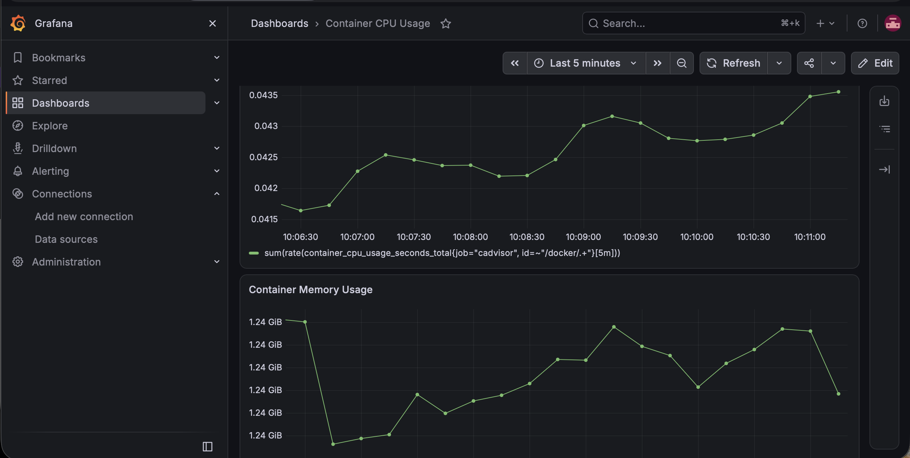
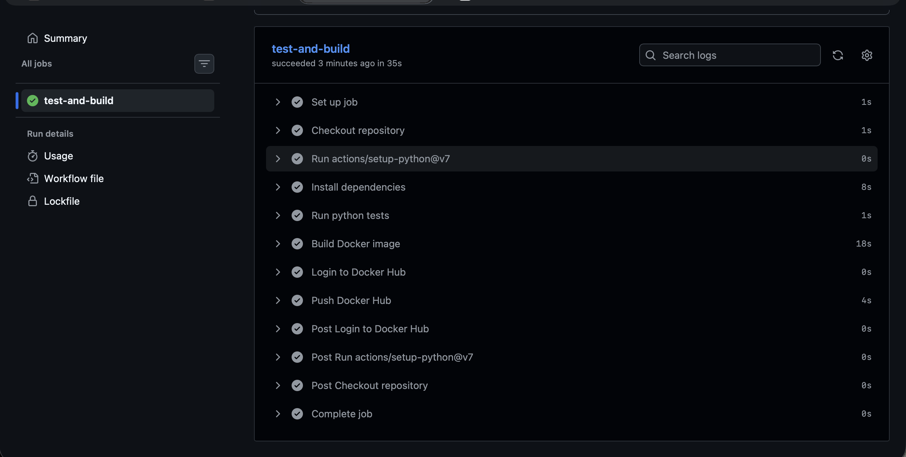

# ContainerWatch

A Docker-based container and application monitoring project built with FastAPI, Redis, Prometheus, Grafana, and cAdvisor. ContainerWatch collects HTTP metrics and container resource metrics and visualizes them through Grafana dashboards.



## Features

- FastAPI endpoints for health checks and a Redis-backed visit counter
- Redis persistence using append-only files and a Docker volume
- HTTP metrics exposed at `/metrics`
- Prometheus scraping FastAPI and cAdvisor every 15 seconds
- Grafana dashboards for HTTP request rate, CPU usage, and memory usage
- Docker Compose setup for five services
- GitHub Actions workflow that runs Python tests, builds an image, and pushes it to Docker Hub

## Tech Stack

**Application:** Python, FastAPI, Redis  
**Containers:** Docker, Docker Compose  
**Monitoring:** Prometheus, Grafana, cAdvisor  
**CI and image publishing:** GitHub Actions, Docker Hub  
**Testing:** pytest, HTTPX

## Architecture

```text
                      Docker Compose
  +------------------------------------------------+
  |                                                |
  |  Client ---> FastAPI API ---> Redis             |
  |                 |                              |
  |                 v                              |
  |              /metrics                          |
  |                 |                              |
  |                 v                              |
  |             Prometheus <--- cAdvisor            |
  |                 |                              |
  |                 v                              |
  |               Grafana                          |
  +------------------------------------------------+

  GitHub push -> GitHub Actions -> Tests -> Docker build
                                      -> Docker Hub push
```

Prometheus scrapes FastAPI and cAdvisor. Grafana queries Prometheus to visualize the collected metrics.

## Getting Started

**Prerequisites:** Docker Desktop or Docker Engine with Docker Compose.

```bash
git clone https://github.com/ilaydacelikkayaa/containerwatch.git
cd containerwatch
docker compose up -d --build
docker compose ps
```

### Local URLs

| Service | URL |
| --- | --- |
| FastAPI | http://localhost:8080 |
| API documentation | http://localhost:8080/docs |
| Health check | http://localhost:8080/health |
| Visit counter | http://localhost:8080/visit |
| API metrics | http://localhost:8080/metrics |
| Prometheus | http://localhost:9090 |
| Prometheus targets | http://localhost:9090/targets |
| Grafana | http://localhost:3000 |
| cAdvisor | http://localhost:8081 |

Call `/visit` a few times to increase the Redis-backed counter and generate API traffic.

### Grafana setup

1. Open Grafana at `http://localhost:3000`.
2. Add **Prometheus** as a data source with URL `http://prometheus:9090`.
3. Create panels using HTTP request metrics and cAdvisor CPU/memory metrics.

The Grafana dashboard is configured manually; it is not automatically provisioned by the current Compose setup. On Docker Desktop for macOS, cAdvisor container labels may be limited.

### Stop the stack

```bash
docker compose down
```

Named volumes retain Redis and Grafana data unless you explicitly remove volumes.

## Testing

With a Python environment and the dependencies installed:

```bash
python -m pip install -r requirements.txt
python -m pytest -v
```

The current test suite includes a health endpoint test.

## CI and Docker Hub

On every push to `main`, the GitHub Actions workflow:

1. Checks out the repository and sets up Python 3.11.
2. Installs dependencies and runs pytest.
3. Builds `ilaydacelikkaya/containerwatch:v1`.
4. Authenticates to Docker Hub using GitHub repository secrets.
5. Pushes the image to Docker Hub.

**Docker Hub image:** [ilaydacelikkaya/containerwatch](https://hub.docker.com/r/ilaydacelikkaya/containerwatch)

**Workflow:** [ContainerWatch CI](https://github.com/ilaydacelikkayaa/containerwatch/actions)

> Publishing an image to Docker Hub is not the same as deploying the application to a server. Automated server deployment is not part of the current workflow. The `v1` tag is reused on each successful push to `main`.

## Screenshots

### Grafana dashboard


### GitHub Actions workflow



> Add the two image files under `docs/screenshots/` before publishing this README so the screenshots render correctly.

## Project Status

The local monitoring stack and CI-based image publishing are implemented. Potential future improvements include automated Grafana dashboard provisioning, versioned image tags, and deployment to a target environment.

## Author

[İlayda Çelikkaya](https://github.com/ilaydacelikkayaa)
